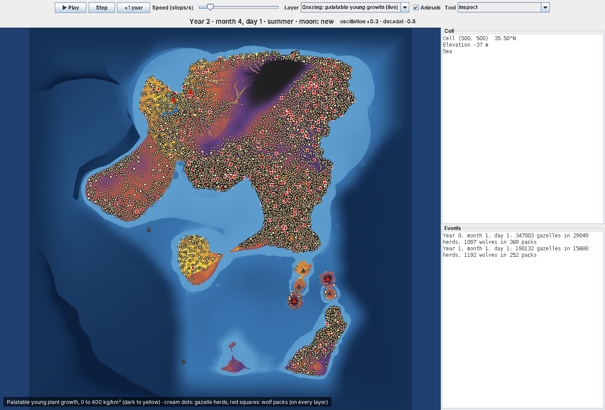
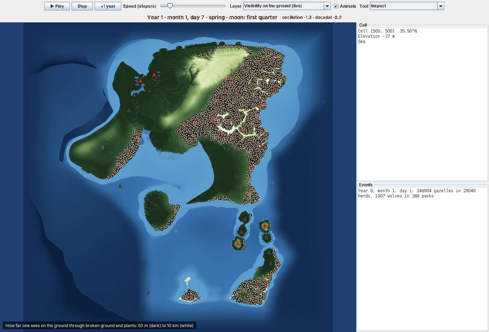
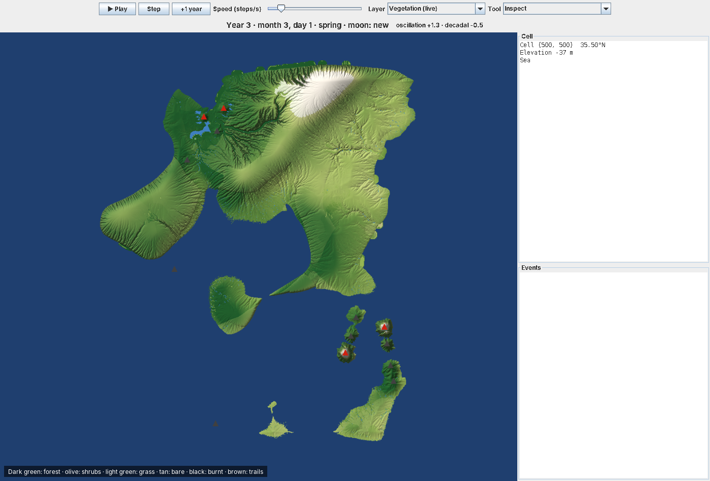

# Inflation

A simulation of how societies, power, debt and money arise, built up from late stone-age groups.
The design brief lives in the project's Claude Doc. This repository starts with the physical world.

## The world

`inflation.world` generates a 1000 × 1000 km region on a 1 km grid (one million cells), spanning
roughly 40°N to 31°N: temperate in the north, hot and dry in the south. The region is an
archipelago of larger landmasses and islands with ocean on every side.

### Generated once

| Layer | Model |
| --- | --- |
| Tectonics | 14 plates on a warped Voronoi map, about half continental (preferring the centre). Continental crust varies in thickness, so parts are drowned into shelf seas between islands. Collisions raise mountain belts, rifts open valleys. Ocean floor deepens with distance from spreading ridges (2.5 to 4.5 km); oceanic plates sinking under others leave trenches. A band along every edge is ocean floor |
| Volcanoes | Arcs 90–160 km behind trenches (continental arcs or island arcs), hotspot chains that age along the plate's motion (active shield at one end, drowned seamounts at the other), and rift cones. Old edifices are eroded with the land, young ones are built afterwards |
| Erosion and sediment | Stream-power law (implicit Braun & Willett 2013 solver, 40 steps × 50,000 years) and hillslope diffusion. Eroded material is carried downstream: rivers drop what exceeds their capacity, closed basins fill, large rivers build delta plains, and the rest builds a sloping shelf out to a shelf break |
| Geology | Rock type per cell (sets erodibility and soil), sediment thickness; flint, clay, obsidian, ochre, salt, copper, tin, bitumen |
| Climate | Monthly normals: latitude, 6.5 °C/km lapse rate, continentality; westerly moisture recharged over open sea, orographic rain and rain shadows; Mediterranean dry summers in the south |
| Rivers and lakes | Thornthwaite evapotranspiration, Fu–Budyko runoff, D8 routing; lakes from a water balance, closed basins turn saline. Valley floors are planed flat beside rivers (width grows with the square root of discharge). Rivers are classed creek, stream, river and great river; reaches with a third of a metre of water and no rapids are navigable by canoe or raft |
| Floodplains | Height above the nearest river (HAND); land a large flood (about ten times mean flow) reaches is floodplain |
| Terrain | Ruggedness from slope, local relief and a rock roughness the 1 km grid cannot resolve (lava fields and karst roughest, alluvium smoothest, buried under thick sediment). Walking effort from Tobler's hiking function, roughness, wetlands and river crossings; open water is impassable on foot. Line of sight over the terrain in 16 directions out to 30 km with earth curvature; prominence over the surroundings; defensibility from height, broken ground and approaches cut by water, marsh or steep slopes |
| Biomes | Potential vegetation from aridity, temperature and drainage, including marsh, swamp forest, bog, salt marsh, mangrove and floodplain forest |

### Over time (`Simulation`)

One step is 6 days (5 steps per month), configurable in `WorldConfig`.

| Process | Model |
| --- | --- |
| Calendar | 12 months × 30 days; the moon is new on day 1 and full on day 16; the year starts at the spring equinox; day length by latitude |
| Weather | Coarse autoregressive temperature and rain anomalies (about five days' persistence), wet and dry years, a quasi-periodic ~5-year oscillation and a decadal swing with their own spatial patterns. Shocks: multi-year droughts (about 1.5% chance a year), severe winters (6%), heat waves (8%), and volcanic winters after VEI 5+ eruptions. Snowpack with degree-day melt |
| Water | Soil bucket (150 mm), groundwater and baseflow; runoff routed down the network every step. Rivers above bankfull (4× mean) flood their floodplains |
| Waterworks | Dams with reservoirs that fill and release steadily, canals that divert part or all of a river (must run downhill and cannot loop), irrigation onto fields, and permanent rerouting of a river |
| Eruptions | Active volcanoes erupt at their own rates; explosivity follows the VEI frequency distribution; ash falls downwind, smothers vegetation and enriches soil |
| Visibility and going | Visibility on the ground is a function of ruggedness and vegetation: broken ground, scrub, forest and reed beds hide anything beyond tens to hundreds of metres; open smooth ground sees as far as the terrain allows. Thickets, undergrowth and snow add to the walking effort |
| Vegetation | Herbs, shrubs and trees per cell, growing towards a ceiling set by recent moisture, warmth and soil. They die back under drought, frost, deep floods, ash and fire, and regrow: herbs within a season, trees over decades and only from nearby seed. Grazing, browsing and felling go through `consume`; animals' passage through `trample`, which wears trails |

### Animals (`inflation.ecology`)

Animals come in three levels of detail. Small, numerous life is a density field per cell; large
animals live in groups (herds, packs). There is one clock: the 6-day world step, the week. A
group is a centre and the range it roams that week; each week it chooses where to centre its
range and how watchful to be. Groups whose ranges overlap are in contact. The choice goes through
a `Policy`: a hand-written baseline, or small networks trained to copy it and then to improve on
it (see Learned behaviour below). The design is in `docs/design/weekly-ranges.md`.

| Layer | Model |
| --- | --- |
| Plankton | Nutrients, phytoplankton and zooplankton in sea and lake cells, stepped daily. Nutrients are rich on shallow shelves and at river mouths, poor over deep water; cold water mixes nutrients up, warm water stratifies. Gives a spring bloom and coasts far richer than open sea |
| Fish | Resident fish in sea and lakes follow primary production (shelves and river mouths far richer than open water); river fish scale with channel size and warmth, shrink with low water, die where the bed nearly dries and come back from downstream. Shellfish beds within about 3 km of the shore in water under 10 m. A spring spawning run (shad-like) gathers off each river mouth and moves upstream about 20 km a day for two months, through lakes, until a cascade or a dam stops it |
| Soil life | Plant litter from turnover, die-back, frost, floods and ash decomposes at a rate set by warmth and moisture; part becomes soil organic matter, which raises the fertility plants grow on. Carcasses rot in days to weeks and feed scavengers |
| Small animals | Plant-eating insects (active above 10 °C, waiting out cold and hot droughts as eggs), biting insects (in warm wetlands and floodwater), rodents (logistic on food, hit by cold and snow) and reptiles and amphibians (breeding in warm, moist weeks, torpid through cold winters and hot, dry summers, when hunters cannot find them), in kg/km², spreading to neighbouring land |
| Water | Ground wetness per cell from soil moisture, recent rain, shade, floods and wetland. Animals drink at rivers, fresh lakes, floodwater, the pools and seeps of very wet ground, and at springs. In dry country, rain that sinks in upslope flows underground and comes up as year-round springs and water holes at the foot of hills, along faults and from limestone; the largest in the driest land are oases that keep the ground around them damp. Herds also get water from fresh food and dew, browsers and gazelles most, aurochs and onagers least, so in the wet season water is everywhere and in the dry season herds gather at rivers and springs |
| Plant food | Young grass and herbs (with a spring flush), browse (deciduous leaves fall in the cold), roots and mast, fruit and nuts (ripening from midsummer to autumn, gone by winter), and standing dead grass and twigs: a stock that builds up over months and is eaten down where herds crowd, so the lean season sets how many grazers the land carries. Big animals digest straw better (Jarman-Bell), pigs poorly, and only as much as fits in the gut |
| Large herbivores | Gazelle, roe, fallow and red deer, ibex, wild boar, aurochs, onager, hippo and brown bear, each with a diet of preferences (grass, browse, roots, fruit; for the bear also small prey and carrion) that shifts towards what its range offers, favoured ground (cover, rugged, wet), comfort temperatures, running speed, foresight and defence. Hippos keep within 1.5 km of water. Each week a herd scores 26 candidate ranges (staying, 8 directions at 3 distances, and its season's range) for food, water, danger, crowding, favoured ground, warmth and what it senses coming; moving costs effort, and a long march costs most of a week's grazing. Overlapping herds share each cell's food in proportion to what they ask, where the food is that they can reach; cliffs keep all but climbers off much of theirs |
| Migration | Each herd carries a map of the seasons: for each month, where it did best. It starts filled in from the climate (the best reachable ground for its kind each month), is corrected by experience, and passes on when a herd splits; a lineage that dies takes its routes with it. Summer and winter ranges end up 30–80 km apart |
| Condition and fat | Fat is stored days of food (about 8 M^0.25 days: a gazelle 17, an aurochs 42), laid on in plenty and most in late summer and autumn, burned first in lean weeks before condition suffers. Predators keep larders. The bear fattens and sleeps through the cold months on its fat |
| Life and death | Births come in each group's season, which drifts towards the months that feed mothers and young best; boar can have two litters a year. Deaths from age and accident, hunger, thirst, cold and heat outside the comfort range (winter coats stretch it), floods, snow and ash, and crowding: beyond what its ground carries a species suffers disease, and now and then an outbreak |
| Predators | Wolf (packs of 3, coursers), lion (prides of 5, which take the largest prey and rob everyone), leopard (pairs, stalkers of broken and wooded ground), striped hyena (mostly a scavenger) and golden jackal (pairs living on rodents, carrion and fawns). Each heads for ranges rich in prey it can catch and away from much stronger predators, which kill weaker ones now and then and drive them off. Over a week a group meets the herds whose ranges overlap its own and tests them, best prospects first. A herd that notices the hunters bunches and defends, and in its own element is hard to beat; surprise (cover for a stalker, a herd that was not watchful) is what predators need, and the young and weak are always easier. Hunger makes animals bold and careless, mothers defend their young, and hungry or thirsty animals fight poorly. Big, armed prey fight back. A kill draws rivals in contact, and a stronger group takes most of it. Groups of a kind whose ranges overlap contest their ground |
| Foresight | Weather and eruptions are drawn a week before they arrive. Each species senses what is coming by its foresight (onagers, gazelles and aurochs keenest): floods and eruptions as dangers, a cold snap or heat wave, and rain on the way in a dry spell |
| Crocodiles and eagles | Not tracked as animals. Crocodiles live in warm rivers and lakes; a herd drinking there may lose one, the young most often, except in the cold months. Eagles hunt over cliff country and take the young of the smaller hoofed animals in the open |

Body mass sets food needs (Kleiber scaling) and starting densities (Damuth's rule). The species
figures are mid-range literature values recalled from memory, not yet checked against sources.

On 400 km test islands (seeds 1, 3, 7 and 11, 21,000–38,000 km² of land), all species but the
lion persist over 20 simulated years on all four; lions die out on three of them. After 20 years,
per km² of land: roe deer 0.9–1.4, wild boar about 0.9, gazelle 0.5–0.9, ibex 0.6–0.8, fallow
deer about 0.5, red deer 0.23–0.29, onager 0.14–0.18, aurochs 0.06–0.1, and one brown bear per
40–45 km²; 120–380 hippos per island. One wolf per 155–190 km², one leopard per 570–1,030 km²,
one striped hyena per 225–405 km² and one jackal per 105–125 km². Herbivores are held by food in
the lean season, crowding disease and predators together.




The step uses every CPU core: cells are stepped in parallel, groups choose in parallel, and
grazing, hunting and births and deaths run on 80 km tiles in parallel (tiles of one chessboard
colour at a time, which cannot touch the same ground). Each group draws from its own random
stream, so a seed gives the same world whatever the threads do. On a 16-thread desktop a 6-day
step takes about 38 ms on the 400 km test island and 320 ms on the full 1000 km map (about 1.4
million animals), some 20 seconds per simulated year.

Measured on seed 7 (`summary.txt`): no lowland below 300 m keeps snow lying even at 40°N. Land at
300–1000 m has it about 10 days a year in the north, land at 1000–2000 m 80–120 days, and mountains
above 2000 m most of the year.


## Learned behaviour (`inflation.learning`)

Each species can decide with a small network (21 inputs, two hidden layers of 32, about 1,800
weights) that scores each range the group could take from the same inputs as the hand-written
baseline. Plain Kotlin, no dependencies; groups decide in parallel on the CPU.

1. **Copying the baseline.** `imitate` runs the world, records a sample of decisions with the
   baseline's score for every option, and fits each species' network to those scores. Held out,
   the networks pick the baseline's best option 96–99% of the time. The copies in `policies/` are
   for the weekly model.
2. **Evolving wolves.** Evolution strategies: each generation draws random directions in weight
   space and tries each in both signs; every wolf pack in a world gets one variant, passed on when
   the pack splits, so one world run compares all of them. Fitness is the wolf-days a variant's
   lineages live per pack they started with: survival and offspring, with no reward for any
   particular way of hunting. Prey keep the baseline.

   One overnight run, on the earlier daily model with 17 inputs (184 generations of 17 variants, each scored on four fresh 800 km worlds over
   3 years, about 2.5 minutes a generation on 16 threads) is in `policies/evolved/`, with its log.
   `compare` (main class `inflation.learning.CompareKt`) pits two networks against each other in
   the same worlds, half the packs each. Against the copied baseline on 8 fresh worlds, generation
   40 lived about 10% more wolf-days and came out ahead in all 8; generation 180 about 5% more,
   ahead in 5 of 8, and ahead of generation 40 in 5 of 8. So evolution found a small gain early
   and little since; the comparison itself scatters by about 5% per world. Prey numbers did not
   fall under the evolved wolves. Those weights do not fit the weekly model's 21 inputs; evolution
   has to be run again on it.

## Running

Requires Gradle 9 (the wrapper is included); a JDK 21 toolchain is downloaded if it is missing.

```
./gradlew test
./gradlew run --args="--seed 7 --out output/seed7"
./gradlew viewer -PviewerArgs="--seed 7"
```

`run` writes PNG maps (relief, biomes, geology, minerals, sediment, rivers, precipitation,
temperature, soil) and `summary.txt`, including snow cover from three simulated years.
Generation takes 45–60 seconds for the full region; `--size 400` makes a smaller one.

`./gradlew fauna -PfaunaArgs="--seed 7 --size 400 --years 25"` runs the living world and prints
animal populations, kills, food and soil each season.
Add `--policies policies` to let the species with a saved network use it.

`./gradlew imitate` records the baseline's decisions and trains one network per species to copy
them, into `policies/`. `./gradlew evolve` (main class `inflation.learning.EvolveKt`) improves the
wolves' network by evolution strategies; see Learned behaviour.

`viewer` opens the map with time controls (play, pause, step, one year ahead, speed), layers
(terrain with live rivers, floods and snow; live vegetation, temperature, rain, soil moisture and
river flow; ruggedness, travel effort, visibility, view from each place, defensibility; grazing, plankton, insects, rodents and soil life; potential biomes; rock; sediment),
herds and packs drawn on the map, a cell inspector, an event log, and tools to build
dams, dig canals, irrigate and clear vegetation. Scroll to zoom, drag to pan.



## Known simplifications

- Rivers use single-direction (D8) routing, randomised during erosion to avoid parallel channels.
- Within a 6-day step, water reaches the river mouth at once, so flood peaks on large rivers come
  early and sharp. Daily temperature extremes are averaged away, which understates lowland snow days.
- Moisture comes from the west and a uniform background; there is no monsoon or explicit storm track.
- The archipelago limits catchment size, so the largest rivers carry a few hundred m³/s, not thousands.
- Vegetation starts from the long-term climate and takes decades of simulated time to settle;
  forests advance only from neighbouring forest.
- Volcanic cones are idealised shapes with noise; lava flows are not modelled, only ash.
- A group's range is summed as the box of equal area on a 2 km grid, and its centre moves in a
  straight line; trails form only where ranges' centres pass often. Trampling scales with the mass
  of animals passing.
- Contact between groups is an expected rate from how much their ranges overlap, not a meeting at
  a place and time.
- The herbivores' food supply (shares of standing herbs, shrubs and trees for each kind of food)
  is a set of calibration constants, not derived from plant physiology.
- Territories are not mapped; spacing comes from overlap with others of the kind. Predator
  numbers follow their prey only loosely, and lions, few and hungry on a 400 km island, mostly
  die out.
- Seasonal ranges start from the climate normals, not from the simulated plants, and herds share
  them only by descent, not yet when kin meet.
- Visibility ignores weather, haze and night for now; the line-of-sight model sees only relief the
  1 km grid resolves, and the finer broken ground enters only through ruggedness.
- The moon's cycle is exactly 30 days to keep months and moons aligned (the real one is 29.53).
