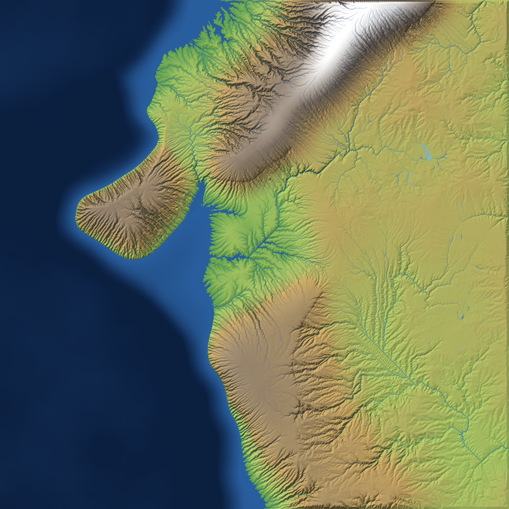
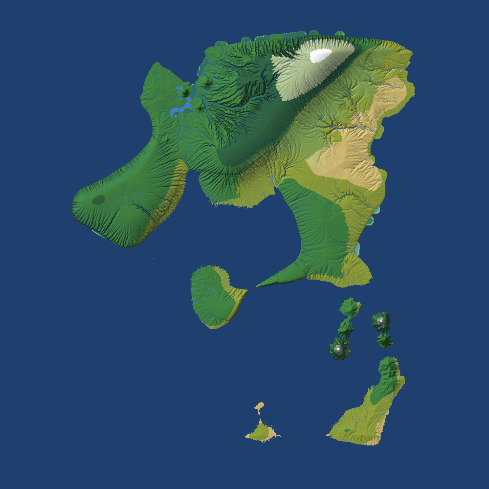
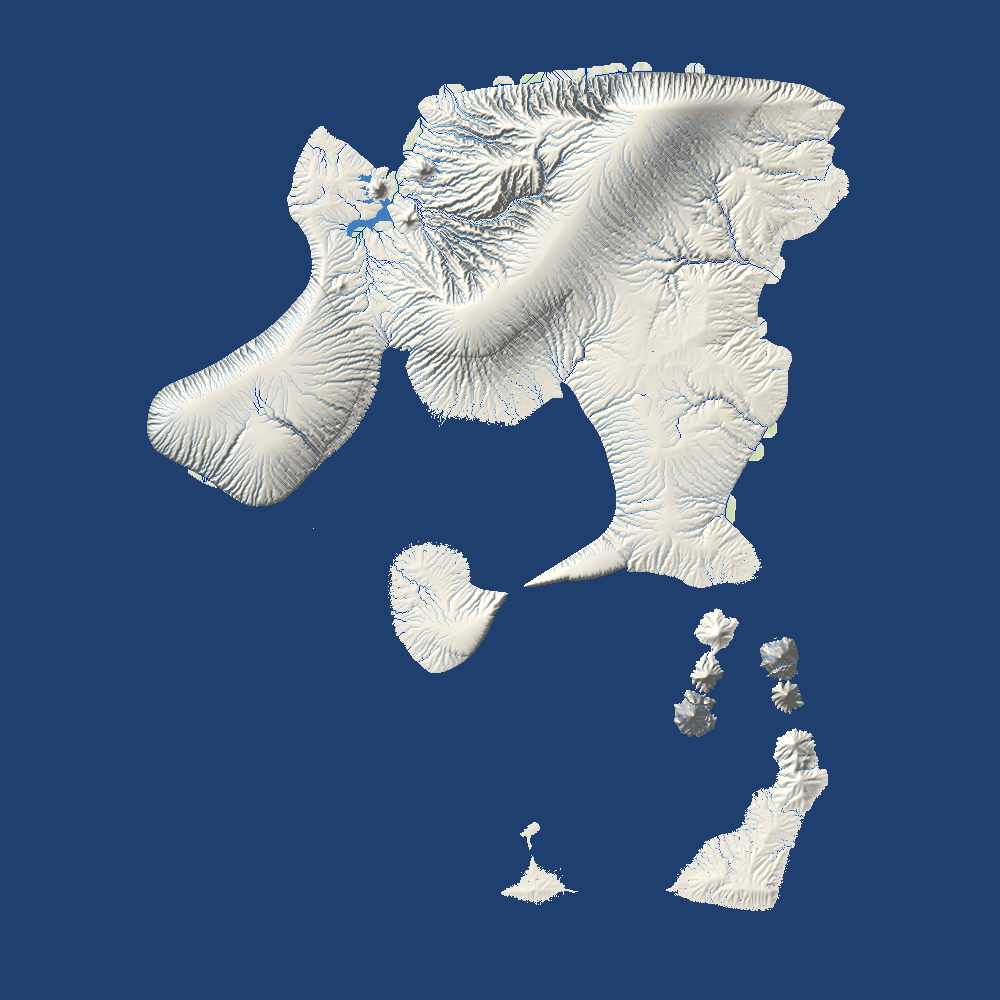

# Inflation

A simulation of how societies, power, debt and money arise, built up from late stone-age groups.
The design brief lives in the project's Claude Doc. This repository starts with the physical world.

## The world

`inflation.world` generates a region 1000 km wide and 2000 km from north to south on a 1 km grid
(two million cells), spanning about 45°N to 27°N, the latitudes from the Black Sea and the Balkans
down to northern Arabia and Sinai: cold continental and alpine in the north, hot and dry in the
south. Latitude follows distance (1° per 111 km), so smaller test maps span fewer degrees around
36°N. The region is one continent-like mass running through every latitude band, with offshore
islands and ocean on every side.
`--size KM` makes a square map, and `--height KM` sets its north–south extent.

### Generated once

| Layer | Model |
| --- | --- |
| Tectonics | About 14 plates per million km² on a warped Voronoi map, 60% continental, chosen nearest the centre against the map's own proportions so land runs its full length. Continental crust varies in thickness and is thickest in the old core, so drowned shelves and inland seas lie mostly on the margins. Collisions raise mountain belts; rifts open valleys with lakes or a narrow gulf (at most 900 m deep), not open ocean. Ocean floor deepens with distance from spreading ridges (2.5 to 4.5 km); oceanic plates sinking under others leave trenches. A band along every edge is ocean floor |
| Volcanoes | Arcs in a line 105–135 km behind trenches where the plates close fast (continental arcs or island arcs), hotspot chains that age along the plate's motion (active shield at one end, drowned seamounts at the other), and rift cones. Old edifices are eroded with the land, young ones are built afterwards |
| Erosion and sediment | Stream-power law (implicit Braun & Willett 2013 solver, 40 steps × 50,000 years) and hillslope diffusion. Eroded material is carried downstream: rivers drop what exceeds their capacity, closed basins fill, large rivers build delta plains, and the rest builds a sloping shelf out to a shelf break |
| Geology | Rock type per cell (sets erodibility and soil), sediment thickness; flint, clay, obsidian, ochre, salt, copper, tin, bitumen |
| Climate | Monthly normals: latitude, 6.5 °C/km lapse rate, continentality; westerly moisture recharged over open sea, orographic rain and rain shadows; Mediterranean dry summers in the south |
| Rivers and lakes | Thornthwaite evapotranspiration, Fu–Budyko runoff, D8 routing; lakes from a water balance, closed basins turn saline. Valley floors are planed flat beside rivers (width grows with the square root of discharge). Rivers are classed creek, stream, river and great river; reaches with a third of a metre of water and no rapids are navigable by canoe or raft |
| Floodplains | Height above the nearest river (HAND); land a large flood (about ten times mean flow) reaches is floodplain |
| Terrain | Ruggedness from slope, local relief and a rock roughness the 1 km grid cannot resolve (lava fields and karst roughest, alluvium smoothest, buried under thick sediment). Walking effort from Tobler's hiking function, roughness, wetlands and river crossings. A river is a sub-cell channel, not a 1 km strip of water: its cost comes from this week's depth (knee deep a wade, waist deep slow, past chest deep a swim most animals refuse), and wide braided reaches on gentle ground have fords while gorges run deep. A stream in spate stops herds; in the dry season the same river can be crossed. Open water is impassable on foot. Line of sight over the terrain in 16 directions out to 30 km with earth curvature; prominence over the surroundings; defensibility from height, broken ground and approaches cut by water, marsh or steep slopes |
| Biomes | Potential vegetation from aridity, temperature and drainage, including marsh, swamp forest, bog, salt marsh, mangrove and floodplain forest |

### The hex world

The world moves on 10 km hexes summarised from the 1 km grid (`HexMap`, `HexWorld`). Each hex is
split into height bands (below 500 m, 500–1000, 1000–1500, 1500–2500 and above); a band of a hex
is a *place*, about 23,000 on the full map. Borders between hexes carry the effort of crossing them
by way of travel (walking, climbing, laden, swimming), with rivers on the hex edges graded by
depth at the best crossing, and cliffs and gorges from the fine terrain. Weather, water and plants
run per place (`HexLand`) at about 2 ms a step.

Animals (`inflation.ecology`):

| Layer | Model |
| --- | --- |
| Soil and small life (`HexSmallLife`) | Litter, organic matter and soil animals; carrion rotting by warmth; plant-eating and biting insects, rodents, reptiles and amphibians, pollinators setting the fruit crop; hares, rock hyrax, six wild birds (quail and greylag geese migrate), tortoises, foxes and wildcats; golden eagles on crags; griffon vulture colonies soaring 80 km for carcasses |
| Resident plant-eaters (`HexFauna`) | Densities per place for the kinds that keep to small home ranges: grazing shared by diet, forage quality, water within reach, crowding disease, shifts between height bands, spill to neighbouring hexes |
| Herds and packs (`HexGroups`) | Migratory herds and the hunters as groups that plan a week's walk over the hexes; meetings on the way are timetabled and settled in order (herds watch and turn aside, hunters chase and stop to eat, rival packs give way or fight); territories, thirst, wariness after a chase, hiding in cover, moonlight, seasonal memory |
| Sense of direction (`HexBearings`) | Each month every kind knows the country within 60 km and the peaks it can see out to 200 km, and feels which way is cooler or warmer when the month is wrong for its coat; groups far out of their country trek that way |

What is ported from the earlier 1 km model and what is not is in `docs/design/hex-port-status.md`.

### Over time on the fine grid

The fine grid's own weekly weather, water and plants (`Weather`, `LiveWater`, `Vegetation`) are
kept as the reference the hex versions are checked against (`HexLandCheck`, `HexWeatherCheck`).
One step is 6 days (5 steps per month), configurable in `WorldConfig`.

| Process | Model |
| --- | --- |
| Calendar | 12 months × 30 days; the moon is new on day 1 and full on day 16; the year starts at the winter solstice (month 1 about January) and a run at the spring equinox; day length by latitude |
| Weather | Weekly weather regimes with their winds: westerly fronts, cold northerly outbreaks, warm southerlies, blocking highs, and the summer high with steady north winds over the south. The jet stream lies over the north in summer and moves south in winter, meandering week to week. Rain falls on the slopes facing the week's wind, with rain shadows behind ridges and volcanoes, and still averages to the normals. The wind drives fire spread, ash plumes and sea upwelling, and is known a week ahead. On top of that: coarse autoregressive temperature and rain anomalies (about five days' persistence), wet and dry years, a quasi-periodic ~5-year oscillation and a decadal swing with their own spatial patterns. Shocks: drought years over a region (12% chance a year somewhere), multi-year droughts (about 1.5% chance a year), severe winters (6%), heat waves (8%), and volcanic winters after VEI 5+ eruptions. Snowpack with degree-day melt |
| Water | Soil bucket (150 mm), groundwater and baseflow; runoff routed down the network every step. Rivers above bankfull (4× mean) flood their floodplains |
| Waterworks | Dams with reservoirs that fill and release steadily, canals that divert part or all of a river (must run downhill and cannot loop), irrigation onto fields, and permanent rerouting of a river |
| Eruptions | Active volcanoes erupt at their own rates; explosivity follows the VEI frequency distribution; ash falls downwind, smothers vegetation and enriches soil |
| Vegetation | Herbs, shrubs and trees per cell, growing towards a ceiling set by recent moisture, warmth and soil. They die back under drought, frost, deep floods, ash and fire, and regrow: herbs within a season, trees over decades and only from nearby seed. Grazing, browsing and felling go through `consume`; animals' passage through `trample`, which wears trails |

Measured on seed 7 (`summary.txt`): no lowland below 300 m keeps snow lying even at 40°N. Land at
300–1000 m has it about 10 days a year in the north, land at 1000–2000 m 80–120 days, and mountains
above 2000 m most of the year.





## Learned behaviour (`inflation.learning`)

A herd kind can choose where to go each week with a small network (`HexLearning`: 22 inputs, two
hidden layers of 32) that scores the places it could reach, from the same inputs as the
hand-written rule. It is first fitted to copy the rule, then evolved by evolution strategies on
600 km mountain worlds, with fitness from how long a lineage lives and grows. Plain Kotlin, no
dependencies. Seasonal migration training is paused until the hex model has the 1 km model's
fundamentals.

## Running

Requires Gradle 9 (the wrapper is included); a JDK 21 toolchain is downloaded if it is missing.

```
./gradlew test
./gradlew run --args="--seed 7 --out output/seed7"
./gradlew hexViewer -PviewerArgs="--seed 1"
./gradlew hexFauna -PfaunaArgs="--seed 1 --years 10"
```

`run` writes PNG maps (relief, biomes, geology, minerals, sediment, rivers, precipitation,
temperature, soil) and `summary.txt`, including snow cover from three simulated years.
Generation takes 45–60 seconds for the full region; `--size 400` makes a smaller one.

`hexViewer` opens the hex world over the fine terrain with time controls; herds and hunters glide
from hex to hex, tints show weather, water, plants, small life and resident herds, arrows show the
wind or a kind's sense of direction, and clicking a hex lists everything living there.
Picking a group in the list and pressing Follow… opens the follow window: its local map (the
country a band does not know dimmed, its way over the last four weeks, the pull of its round or
season's place), how it stands and who shares its hex, what it knows of itself and of each place it
can reach, the places coloured by how the model scores them with the model's pick in yellow, and its
ways for the week. Click another place or pin a way to override the model; Next step runs the week,
and the next week then waits at the group's choice (unless "Model decides" is ticked). The
overview's Run and Step take over: their weeks run on the model's choices. `--nets DIR` (or
`nets=DIR`, with `ways=FILE`, in the config file) makes the learned networks the model, as in `hexFauna`;
without them it is the hand-written choices.

`hexFauna` runs the hex world for some years and prints each kind's numbers, the small life, the
causes of death and the cost of a step, and for people a line against the ethnographic record (band
size, density, camp moves, ground walked, plant share of food, birth spacing, children reaching 15,
years left at 15, violent deaths). `--uniform` starts every kind spread evenly over the land;
`people=false` in the config file leaves people out, for comparison; `huntDiag=KIND` traces hungry
and thirsty groups of a kind.

Run settings other than seeds, years and sizes are keys in a config file, not switches:
`inflation.properties` in the directory the run starts in (the project directory for the Gradle
tasks), or the file `-Dhex.config=FILE` names. `config.example.properties` lists every key with its
default. A mechanic that has replaced an older way gets no key to bring the old way back; keys are
kept for what runs really vary: the networks and paths, features still being tried (`rounds`,
`taming`), and values under study (`t.*`).

A running world can be saved and carried on after small changes to the code: `--save FILE` (every
five years and at the end) and `--load FILE` in `hexFauna`, Save…/Load… and `--load FILE` in the
viewer. Fields are matched by name, so a field added since keeps its fresh value and one removed is
dropped. The generated world itself is kept in `~/.inflation/world-cache` and loaded in seconds
while the world-generating code and settings are unchanged (`worldCache=false` turns this off).

Short tests start from settled test worlds rather than from year 0, so they see a change's effect
and not the first years' swings. `./gradlew testWorld -PtestArgs="build full-1 full-2 full-3"` runs
each of the three full-map seeds for 30 years (`--years N`) under the config file's keys and keeps it
in `~/.inflation/test-worlds`; `testWorld -PtestArgs="list"` shows what is built and from which
commit. A change is tested with `testWorld -PtestArgs="ab --variant change.properties"`: the base and
the variant (the change's keys laid over the base config) run for 3 years on each full map, twice
with the weather drawn differently (`--years`, `--replicates`, `--parallel`, `--worlds`), and the
report gives each kind's effect paired by weather, the base's own swing with the weather, and whether
every pair went the same way. A settled world still drifts, so a change is never judged against older
numbers, only against its base. Smaller maps did not track the full map (see `TestWorlds.kt`);
`small-1` is kept for checking that code runs. `hexFauna --world NAME --years N [--replicate R]`
carries one settled world on by itself.

## Known simplifications

- Rivers use single-direction (D8) routing, randomised during erosion to avoid parallel channels.
- Within a 6-day step, water reaches the river mouth at once, so flood peaks on large rivers come
  early and sharp. Daily temperature extremes are averaged away, which understates lowland snow days.
- Moisture comes from the west and a uniform background; there is no monsoon or explicit storm track.
- The archipelago limits catchment size, so the largest rivers carry a few hundred m³/s, not thousands.
- Vegetation starts from the long-term climate and takes decades of simulated time to settle;
  forests advance only from neighbouring forest.
- Volcanic cones are idealised shapes with noise; lava flows are not modelled, only ash.
- The herbivores' food supply (shares of standing herbs, shrubs and trees for each kind of food)
  is a set of calibration constants, not derived from plant physiology.
- The moon's cycle is exactly 30 days to keep months and moons aligned (the real one is 29.53).
